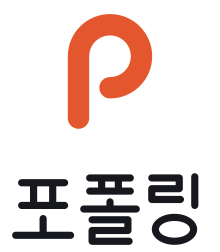

<p align="center">
  <picture>
    <source media="(prefers-color-scheme: dark)" srcset="docs/assets/logo-lockup-dark.svg">
    
  </picture>
</p>

# 포폴링 (POPOL-ing)

내 프로젝트가 무엇이 있는지 한눈에 보고, 바로 실행하고, 계속 실행 가능한 상태로 관리하는 데스크톱 앱이에요.

이름은 포트폴리오의 줄임말 '포폴'에 진행 중을 뜻하는 '-ing'를 붙였어요. 내 포트폴리오가 지금도 살아 있고 계속 쌓여 간다는 뜻이에요.

> **지금 상태:** 개발 중이에요(2026년 11~12월, 최종 발표 2026-12-17). 아직 내려받을 수 있는 빌드는 없어요.

## 왜 만들었나요

프로젝트가 많아지면 이런 일이 생겨요.

- 예전 프로젝트가 무엇이었는지, 어떻게 실행하는지 잊어버려요.
- 프론트·API·DB를 터미널 여러 개에서 하나씩 띄워야 해요.
- 그사이 버전이 바뀌어서 다시 실행하면 안 돌아가요.

포폴링은 이런 프로젝트를 한곳에 모아 두고, 버튼 하나로 띄우고, 안 되면 왜 안 되는지 알려 줘요.

## 무엇을 할 수 있나요

첫 버전은 **개발 프로젝트**를 대상으로 아래 기능을 만들고 있어요.

| 기능 | 하는 일 |
|---|---|
| 프로젝트 카탈로그 | 등록한 프로젝트를 목록으로 보고, 설명·기술 스택·저장소 링크를 메모해 둬요 |
| 전체 실행·종료 | 프론트·API·DB 같은 항목을 정해 둔 순서대로 한 번에 띄우고 꺼요. 포폴링이 띄운 것만 꺼요 |
| 포트·환경 점검 | 실행 전에 포트가 비어 있는지, 필요한 도구(Node·Java·Docker 등)가 깔려 있는지 확인해요 |
| Docker Compose | 등록한 Compose 프로젝트를 띄우고 끄고, 상태와 로그를 보여 줘요 |
| 원격 연결 확인 | 클라우드에 있는 서버·DB는 켜고 끄지 않고, 연결되는지만 확인해요 |
| 헬스체크 | 띄운 서버가 제대로 응답하는지 확인해요 |
| 실행 환경 기록·비교 | 마지막으로 성공했을 때와 지금 무엇이 달라졌는지(도구 버전 등) 보여 줘요 |
| Git 상태 | 현재 브랜치, 커밋하지 않은 변경, 원격보다 뒤처진 커밋 수를 보여 주고, 실행 전에 최신 코드를 받아요 |
| AI 검사 (Gemini) | 실행이 실패한 원인을 분석하고, 헬스체크 결과를 두세 문장으로 요약해요 |

설정은 프로젝트 폴더의 `ppoling.yaml` 하나에 적어요. 형식은 [개발기획서](docs/포폴링_개발기획서.md)에 있어요.

## 안전하게 만들려고 지키는 것

- 포폴링이 띄우지 않은 프로그램은 끄지 않아요. 다른 프로그램이 포트를 쓰고 있으면 알려만 줘요.
- `.env`에 있는 값(비밀번호·키)은 화면과 로그에 그대로 보여 주지 않아요.
- 다른 사람이 만든 `ppoling.yaml`은 처음 열 때 실행될 명령을 먼저 보여 주고, 확인을 받은 뒤 실행해요.
- AI 검사는 보낼 내용을 먼저 보여 주고, [보내기]를 눌러야 Google로 보내요. `.env` 값과 API 키는 보내지 않아요. API 키는 각자 자기 키를 넣어요.
- 프로젝트를 지워도 앱 목록에서만 빠져요. 폴더와 설정 파일은 그대로예요.

## 기술 스택

- **Flutter 데스크톱** (macOS·Windows)
- Windows 프로세스 제어는 Dart FFI로 Win32 API를 불러요
- AI는 **Gemini API** (`gemini-flash-latest`)

## 개발 시작하기

```sh
git clone https://github.com/App-Legend/POPOL-ing.git
cd POPOL-ing
git switch dev
cd app
flutter pub get
flutter run -d macos     # Windows는 -d windows
```

필요한 도구와 테스트 방법은 [위키의 개발 환경 설치](https://github.com/App-Legend/POPOL-ing/wiki/개발-환경-설치)에 있어요.

## 저장소 구조

기능마다 폴더(패키지)를 나누고, 기능끼리는 `core/`에 정해 둔 계약으로만 주고받아요.

| 폴더 | 하는 일 |
|---|---|
| `app/` | 앱 시작점. 기능을 모아 화면을 조립해요 |
| `core/` | 기능 사이에 주고받는 데이터·계약·이벤트, 공통 UI, 가짜 구현 |
| `runner/` | 실행·종료·로그·실행 기록·복구 |
| `project/` | 프로젝트 등록, 설정 파일, 메모 |
| `checks/` | 포트·HTTP 확인, 환경 점검, 환경 기록·비교 |
| `compose/` | Docker Compose 제어, 원격 연결 항목 |
| `catalog/` | 카테고리 선택, 프로젝트 카탈로그 |
| `ai/` | AI 검사(Gemini API) |
| `docs/` | 기획서·일정·역할분담 |

## 문서

- [개발기획서](docs/포폴링_개발기획서.md): 무엇을 왜 만드는지, 기능 목록, 인수 테스트
- [6주 개발일정](docs/포폴링_6주_개발일정.md)
- [역할분담](docs/포폴링_역할분담.md): 4명이 A~D 역할로 나눠 맡아요
- [위키](https://github.com/App-Legend/POPOL-ing/wiki): 처음 온 사람을 위한 안내
- [문제 해결 기록](TROUBLESHOOTING.md)

브랜치는 `feat/<기능명>` → `dev` → `main` 순서로 PR을 통해 합쳐요. 자세한 규칙은 [위키의 브랜치와 PR 규칙](https://github.com/App-Legend/POPOL-ing/wiki/브랜치와-PR-규칙)을 보세요.
